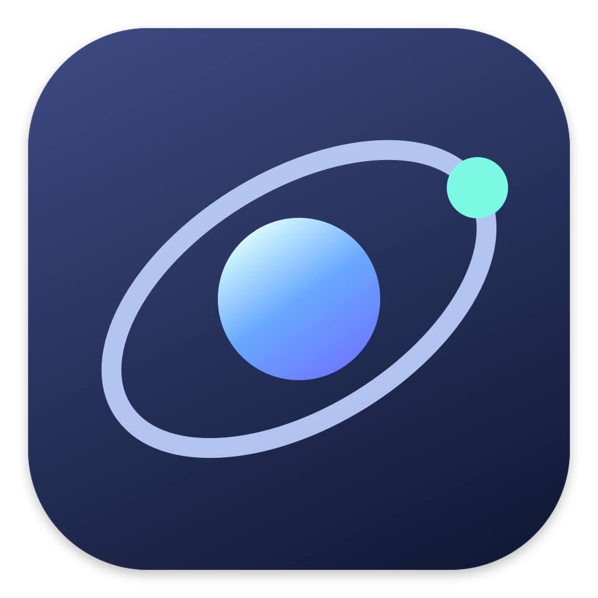

<p align="center"></p>
<h1 align="center">Orbit for macOS</h1>

Orbit brings your devices, battery information, media and everyday controls together around the Mac’s notch, menu bar and desktop. Formerly NotchFlow, it retains its existing features and adds native battery widgets and refreshed Settings.

## Orbit 3.0 — Public

- **Battery menu:** coloured percentage icon, charging indicator inside the battery, power input and draw, health, cycles and history.
- **Native widgets:** rings, list or bars; small through extra large; choose devices per widget, or keep the lowest available battery first. Optional monochrome and list progress bars.
- **Device batteries:** Mac, connected AirPods earbuds, fresh case readings when macOS provides them, Bluetooth audio, supported mouse/keyboard/trackpad batteries, optional nearby Bluetooth battery-service reads and an optional trusted iPhone/iPad USB/Wi-Fi reader.
- **Everyday tools:** media controls, timers, break reminders, recording status, Stats, window snapping, clipboard, Shelf, notes, calendar, downloads, shortcuts and existing integrations.
- **Refreshed Settings:** grouped navigation, distinct page colours, clearer typography, search, and system/light/dark themes.

The existing notch opening/closing animations and camera-safe sizing are retained.

## Device setup

Open **Settings → Batteries & Widgets**. Enable nearby Bluetooth discovery and choose **Track battery** for the devices you want. Orbit scans briefly once a minute, connects only to selected devices, reads the standard Battery Service when exposed, then disconnects. macOS may request Bluetooth permission or pairing. iPhone/iPad support depends on what the device and OS expose; discovery alone does not guarantee a battery reading. Bluetooth reads do not report charging state.

The optional trusted-device reader uses macOS’s MobileDevice framework. It reads already-trusted iPhones/iPads over USB or a reachable Wi-Fi sync connection; it never pairs a device or changes sync settings. This route may require connecting once, unlocking and approving Trust, then enabling Wi-Fi visibility in Finder. Detailed phone health and Apple Watch battery are not included.

Add desktop/Notification Center widgets through **Edit Widgets → Orbit Batteries**. Right-click a widget → **Edit Widget** for style and device choices. Empty device selection means Automatic. Widgets follow macOS’s refresh scheduling; they are not one-second live displays. Missing/stale readings remain unavailable and show their update age.

## Updating from NotchFlow

Orbit keeps the established bundle identity and keychain service identifiers. Existing preferences and sign-ins remain in their original internal domains. On first Release launch, saved files move from the `NotchFlow` folders in Application Support, Documents and Caches into `Orbit`. Conflicting files are preserved in a recovery folder; battery histories are merged by timestamp. Development builds use separate storage and do not migrate Release data.

The installed application is **Orbit.app**. Legacy internal type/module identifiers remain for compatibility; these are not additional apps.

## Build

Open **Orbit.xcodeproj**, scheme **Orbit**. The main Swift module remains `NotchFlow` for compatibility with existing tests. A recent Xcode supporting the project’s SDK APIs is required; main-app macOS deployment target is 14.6. Widget sizes/features vary by macOS version.

```sh
xcodebuild -project Orbit.xcodeproj -scheme Orbit -configuration Release \
  -destination 'generic/platform=macOS' -derivedDataPath build CODE_SIGNING_ALLOWED=NO build
```

Unsigned compilation does not provision runnable widgets. For your own signed build, set your development team and matching team-prefixed app group in the main app/widget entitlements and `OrbitShared/OrbitBatterySnapshot.swift`. Use the separate development entitlements for Debug. Never commit signing keys or service credentials.

The local signing script requires a certificate identity argument and preserves the app’s existing permissions. General-download signing/notarization must be completed before presenting a binary as a notarized public installer. Source availability and the in-app Public release label do not imply notarization.

## Measurement limits

Adapter capacity is separate from measured charging input. Input cadence depends on macOS telemetry; battery draw prefers instantaneous current when available. App energy is partial main-process CPU attribution and excludes display/GPU/helpers. Native Mac/AirPods alert dismissal is a conservative Accessibility-based trial, may depend on alert layout/language and requires real-alert verification. No new temperature or charge-control helper is included.

## Privacy and attribution

See [Privacy](PRIVACY.md), [GPL licence](LICENSE), [Notice](NOTICE), [Assets copyright](COPYRIGHT_ASSETS) and [Trademarks](TRADEMARKS). Orbit is derived from [Atoll](https://github.com/Ebullioscopic/Atoll) and preserves its contributor and third-party notices. AirPods 4 artwork is credited to Falah3D under CC BY 4.0 in NOTICE. The new Orbit icon is original vector artwork. Juicy informed battery UX research; its source and artwork are not bundled.

Private settings, battery history, diagnostic snapshots, signing credentials and local build caches are excluded from the public source export.
